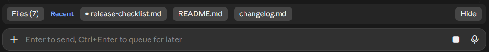
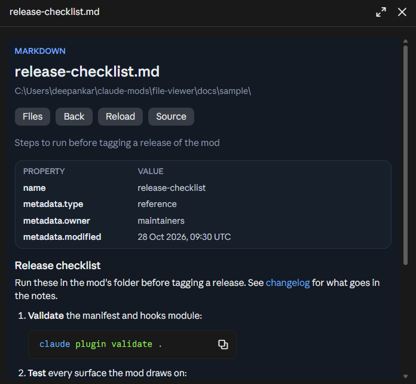
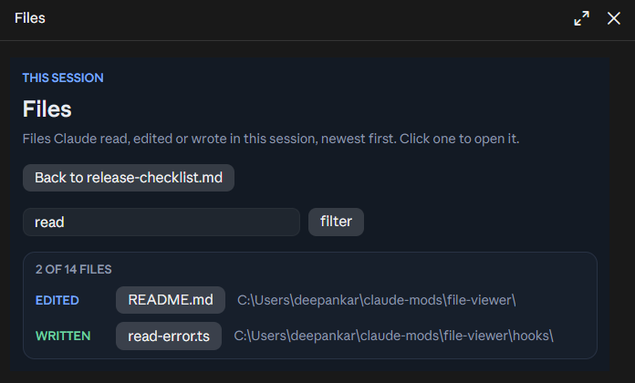

# file-viewer

[](LICENSE)
[](https://github.com/deepankar17/claude-file-viewer/stargazers)
[](https://github.com/sponsors/deepankar17)

A Claude Code mod that opens any file on disk in a pane beside the chat, including the files the
desktop app's own file pane refuses with "This file is outside this session's folders" (memory
files under `~/.claude/projects/...`, for example).

- **Files bar** above the prompt: `Files (N)` lists every file Claude read, edited or wrote in this
  session, and your recently opened files are one click away. `Hide` tucks the bar away;
  `/view-file` brings it back.
- **Markdown** is formatted: frontmatter becomes a properties card, `[[name]]` links open the
  sibling file, and `Source` shows the raw text. Other files show as code.
- **Slate palette** that follows the app's light or dark theme.
- `/view-file <path>` opens any file; you can also ask Claude to open one (the `open_file` tool).

The Files bar above the prompt:



A markdown file, its frontmatter shown as a properties card:



The files Claude touched in this session, narrowed by the filter:



## Install

At the prompt of a Claude Code terminal session:

```
/plugin install file-viewer --marketplace deepankar17/claude-file-viewer
```

Answer `y` to add the marketplace, then pick a scope (user scope loads it in every session).

From a shell:

```bash
claude plugin install file-viewer --marketplace deepankar17/claude-file-viewer
```

In the Claude desktop app, where `/plugin` does not run: click **+** next to the prompt box, then
**Plugins**, **Add marketplace** with `deepankar17/claude-file-viewer`, then **Add plugin**.

Installed at the user scope from a terminal, the mod also loads in the desktop app's Code tab.

## Update

```bash
claude plugin update file-viewer@claude-file-viewer
```

Then run `/reload-plugins` in open sessions.

## Develop

```bash
claude plugin validate .
claude plugin test .
```

## License

[MIT](LICENSE) © 2026 Deepankar Sarkar
